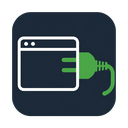

# BrowserPlug



The be-all-end-all MCP for your browser. BrowserPlug uses less of your context window, less memory and better performance while retaining key capabilities. Built over a span of 4 months, tested on real projects, hardened by multiple models and harnesses.

https://github.com/user-attachments/assets/9fb5fd8d-544e-4fa6-9b7a-63190c4be59d

[](https://github.com/MarcinWolnyEU/browserplug/actions/workflows/ci.yml)
[](https://github.com/MarcinWolnyEU/browserplug/actions/workflows/security.yml)
[](https://scorecard.dev/viewer/?uri=github.com/MarcinWolnyEU/browserplug)
[](https://github.com/MarcinWolnyEU/browserplug/releases/latest)
[](https://github.com/MarcinWolnyEU/browserplug/blob/main/LICENSE)
[](https://www.python.org/)
[](https://github.com/astral-sh/ruff)
[](https://github.com/astral-sh/uv)

## Capabilities

With BrowserPlug connected, an MCP client can work in your browser:

- **Authenticated web apps**: read and act on sites you are signed into, without API keys
- **Page reading**: open a page and get its main content as markdown in one call, or read one iframe or CSS subtree
- **Live debugging**: reload your dev server's page and read the failed requests and console errors
- **Form filling**: fill and submit a form in one call, with each step's effect reported
- **Data extraction**: turn a product grid or search results into rows of title, link and price
- **Network inspection**: list a tab's recent requests, or start a capture for headers and bodies
- **Screenshots**: capture the viewport, one element or the full page
- **JavaScript**: run code in the page, or a script from your own folder
- **Several agents and browsers**: share one server, connect several browsers, pick one per agent
- **Remote browsers**: connect a browser on another machine, Firefox for Android included
- **Tor and SOCKS**: route traffic through a SOCKS proxy, BrowserPlug also comes with integrated support for `.onion` sites
- **Quota panels**: see Claude, Codex and Copilot usage limits next to the agent spending them

## Try it

```text
Open my GitHub notifications in a background tab and list the pull requests waiting for my review.
```
The agent opens its own tab, which loads signed in, and reads it as markdown in the same call.

```text
Search eBay for "1500VA pure sine UPS" and give me the ten cheapest listings as a table with links.
```
`page_snapshot(mode="records")` gives one row per listing, each price read from its own card.

```text
Log in to my dev server at localhost:3000 with the test account and find out why the dashboard fails.
```
`page_act` fills and submits in one call; its result names any failed POST or console error.

```text
Click Save on this settings page and show me the API request it sends, with headers and body.
```
The agent starts a `requests` capture, then clicks; `Cookie` and `Authorization` show as `<redacted>`.

## How it works

```
MCP client ──stdio──▶ launcher (one per client)
                         │  finds the shared server, or starts it
                         ▼
                      server (one per machine)
                         ├─ MCP over HTTP on localhost:2830
                         └─ WebSocket on localhost:8772 ◀── extension in each browser
```

Each stdio client starts a launcher, a relay that needs only the Python standard library. The
first one starts the server in the background, later ones reuse it, and it outlives them. HTTP
clients call `http://localhost:2830/mcp` directly. The extension holds an encrypted WebSocket
to the server and acts through browser extension APIs; it opens no remote debugging port. Each
browser runs three calls at a time and queues 24 more; past that a call returns `BROWSER BUSY`,
which says it was never sent and is safe to retry.

## Compared with other browser MCP servers

| MCP | Tools count | `tools/list` tokens | Tokens on loading wikipedia | Minimal wait time | Browser per-client | Browser mode | RAM usage, 1 client | RAM usage, 5 clients |
|---|---|---|---|---|---|---|---|---|
| BrowserPlug | 9 | 7,069 | 8,674 (`read="markdown"`) | 280 ms default, 125 ms with `wait="dom"`, 21 ms with `wait="load"` | No | Headed (your own browser) | 123 MiB | 198 MiB |
| Playwright MCP | 25 | 6,796 | 56,424 (`browser_snapshot`) | 43 ms | Default yes | Default headed | 103 MiB | 518 MiB |
| chrome-devtools-mcp | 30 | 9,931 | 69,418 (`take_snapshot`) | 134 ms | Default yes | Default headed | 120 MiB | 602 MiB |
| Selenium MCP | 18 | 3,907 | 7,456 (`get_element_text` on `body`, text only) | 32 ms | Always yes | Default headed | 79 MiB | 397 MiB |

What it can reach:

| MCP | Your logged-in session | Chrome | Firefox | Safari | Remote in LAN | Remote external IP | Proxy connections | Content filtering | Collects telemetry |
|---|---|---|---|---|---|---|---|---|---|
| BrowserPlug | always | yes, plus Edge and Brave | yes, plus Zen, LibreWolf, Firefox for Android | no | yes: browsers on other LAN machines connect with a device token over an encrypted socket; `/mcp` itself is loopback only | yes, in WAN mode (same socket; the HTTP port has no TLS, a tunnel is advised) | per-tab SOCKS4/5 and Tor, off until you allow it; no HTTP, PAC or authenticated proxies; Chromium switches the whole browser | headers always redacted, body censoring and custom patterns opt-in, output caps; no site allow or block list | none; the usage panels call claude.ai and github.com with your cookies (on by default, each can be switched off) |
| Playwright MCP | opt-in: `--extension` (Chrome and Edge only) or `--cdp-endpoint` to a Chrome with a debugging port | yes | yes, not your logged-in session | no (its WebKit build is not Safari) | yes: `--cdp-endpoint` or `--endpoint` to any host, no auth or TLS added | same flags, any address | `--proxy-server` (HTTP, SOCKS5); credentials only in the config file | `--allowed-origins` and `--blocked-origins` (documented as not a security boundary), `--secrets` masking, file-system guard | none found |
| chrome-devtools-mcp | opt-in: `--autoConnect` (Chrome 144+, you click Allow) or `--browserUrl` / `--wsEndpoint` | yes | no | no | yes: `--browserUrl` / `--wsEndpoint`; the debug port has no auth or TLS, its docs advise an SSH tunnel | same flags, tunnel advised | `--proxyServer`, no auth, only for a Chrome it launches | `--blockedUrlPattern` / `--allowedUrlPattern`, `--no-javascript-evaluation`, `--redactNetworkHeaders` (off by default) | yes: usage statistics to Google by default (`--no-usage-statistics`), CrUX lookups for traces (`--no-performance-crux`) and a daily npm update check |
| Selenium MCP | no attach route; a real profile passed in `arguments` starts a new browser and fails if the profile is open | yes | yes, not your logged-in session | yes, macOS only | only through `SELENIUM_REMOTE_URL`, undocumented, new session each time | same variable, any address | none in the MCP; Chrome and Edge take `--proxy-server` through `arguments` | none | yes: Selenium Manager posts to plausible.io on every `start_browser` (`SE_AVOID_STATS=true` stops it) |

How the numbers were made, on 2026-10-08, Windows 11, one page: https://en.wikipedia.org/wiki/Web_browser.

- **Tokens** are Opus 5.5 prompt tokens. Each payload went through OpenRouter (served by Amazon Bedrock) as a request with `max_tokens=1`, and the `usage` field gave the count, minus 9 for the one-character message that carries it. Anthropic's own `count_tokens` was not used because that account had no credit. Tool lists were sent as the `tools` parameter, which adds about 320 tokens of fixed tool preamble to every row.
- **Tokens on loading** are the total for getting the page's text: the default navigation call, which returns only a title or status line, plus the follow-up call that returns the text. The follow-up is named unless it is the default call. BrowserPlug's is `read="markdown"` (the first 20,000 of 41,634 characters); Playwright MCP and chrome-devtools-mcp use their accessibility snapshot; Selenium MCP uses the body text, since it has no snapshot tool.
- **Minimal wait time** is one navigation call to a ~100-byte page on localhost, each sample starting from `about:blank` with a warm cache, timing only the call. Two rounds of 20 samples, the second in reverse tool order; the figure is the mean of the two round medians. The machine was in ordinary use, so differences of a few milliseconds mean nothing. The defaults differ: BrowserPlug's default `wait="settled"` waits for load, commit, no request in flight and 250 ms of network quiet; `wait="dom"` returns once the DOM has been unchanged for about 100 ms, which is what chrome-devtools-mcp does; `wait="load"` and the other three tools return at the load event. The BrowserPlug figures were taken in the same harness, in a separate run on 2026-10-12, 20 samples per round.
- **Browsers**: Chrome for Testing 154 for every tool. BrowserPlug ran in the repo's test harness (headless, empty profile, sandbox ports). Versions: @playwright/mcp 0.0.83, chrome-devtools-mcp 1.10.1, @angiejones/mcp-selenium 0.2.3.
- **Workarounds**: Selenium MCP needed a shim for this machine's loopback adapter list. Cold start was not measured.
- **RAM** is the private bytes of each client's process tree: the MCP process and everything it starts, such as `chromedriver` for Selenium MCP. For BrowserPlug that is one launcher per client plus the shared server's two processes. Chrome is excluded from every row, including the BrowserPlug extension, which runs inside Chrome (86 MiB, not counted). One client is the first client; five clients means five, each with its own browser. Each figure is the median of three runs with a 10-second settle. Every tool ran headless with an isolated profile, so none touched your browser. A child process counts only if it started after its parent, because Windows reuses process IDs. Measured on 2026-10-12 (BrowserPlug) and 2026-10-12 and 2026-10-13 (the others).
- **Reach** comes from each tool's source and `--help` at those versions; "none found" means a search of the source for outbound requests turned up nothing. "Default yes" under Browser per-client means each client gets its own browser unless you point it at a shared one.

## When not to use it

- **Headless CI**: BrowserPlug drives a browser someone has open; a tool that launches its own
  suits unattended runs.
- **Clean, throwaway profiles**: it works in your own profile and cannot start a fresh one per run.
- **Parallel isolated sessions**: every agent shares your browser's cookies and logins.
- **Performance traces and Lighthouse**: chrome-devtools-mcp has both; BrowserPlug has neither.
- **A one-line install**: setup takes a clone, a Python environment and an extension; there is
  no `npx` command.

## What it exposes

An agent connected to BrowserPlug gets your browser as you use it: every open tab, every site
you are signed into, form input and JavaScript. Connect only MCP clients you trust.

An agent that reads web pages can be steered by them: a page can carry instructions the agent
may follow with your logins. No tool in this category has solved this. For risky work, use a
separate browser profile with the extension and no saved logins.

In the default setup the server listens on localhost only, each browser authenticates with a
device token of its own, and the socket is encrypted (X25519 with ML-KEM-768). The MCP
endpoint answers only local callers. Captured requests show `Cookie`, `Authorization` and
similar headers as `<redacted>`; bodies arrive as sent unless you turn on censoring in Options.

There is no analytics, no account and no BrowserPlug service. The extension's usage panels
call claude.ai and github.com with your cookies (on by default, each can be switched off), and
`proxy="tor"` downloads Tor. [PRIVACY.md](PRIVACY.md) lists every host contacted and what is
stored where.

## Quick start

Store listings on addons.mozilla.org and the Chrome Web Store are in review; until they are
approved, install from source. You need Git, **Python 3.11+** (the server runs on 3.11 or
3.12), and Firefox Developer Edition 140+ or Chrome, Edge or Brave 138+.
[docs/install.md](docs/install.md) has the details and the uv alternative.

### 1. Get the code and set up Python

Clone the repository and install the server's dependencies into a venv outside the checkout:

```powershell
# Windows (PowerShell)
git clone https://github.com/MarcinWolnyEU/browserplug.git; cd browserplug
py -3.12 -m venv "$env:LOCALAPPDATA\browserplug\venv"
$py = "$env:LOCALAPPDATA\browserplug\venv\Scripts\python.exe"
& $py -m pip install --upgrade pip
& $py -m pip install --requirements-from-script server\server.py
```
```bash
# macOS / Linux
git clone https://github.com/MarcinWolnyEU/browserplug.git && cd browserplug
python3.12 -m venv ~/.local/state/browserplug/venv
py=~/.local/state/browserplug/venv/bin/python
"$py" -m pip install --upgrade pip
"$py" -m pip install --requirements-from-script server/server.py
```

### 2. Build the extension

Run `build_xpi.py` with the venv's Python: `& $py build_xpi.py` in PowerShell,
`"$py" build_xpi.py` elsewhere. It writes `dist/firefox/browserplug@marcinwolny.net.xpi` and
`dist/chrome/browserplug-chromium.zip`.

### 3. Load it into your browser

- **Firefox Developer Edition** (release Firefox does not keep unsigned extensions): set
  `xpinstall.signatures.required` to `false` in `about:config`, then in `about:addons` choose
  Install Add-on From File from the gear menu and pick the `.xpi`.
- **Chrome, Edge or Brave**: in `chrome://extensions` turn on Developer mode, click Load
  unpacked and pick `extension-chromium/`. For `page_eval`, also turn on "Allow user scripts"
  in the extension's Details.

### 4. Register it with your MCP client

For Claude Code, with the venv's Python from step 1 and your checkout's path:

```bash
claude mcp add --scope user browserplug -e BROWSERPLUG_SERVER_PYTHON=/abs/path/to/venv/bin/python -- /abs/path/to/venv/bin/python /abs/path/to/browserplug/server/launcher.py
```

Other clients, Codex and direct HTTP: [docs/install.md](docs/install.md#registering-mcp-clients).

### 5. Check it

Start a new client session; its launcher starts the server, and within seconds the plug on the
extension's toolbar button turns green. Ask the agent to list your open tabs. If anything
fails, run `server/preflight.py` with the venv's Python; each failed check names its fix.

## Guides

- [Installing](docs/install.md): uv, both browsers, every client, troubleshooting
- [The server](docs/server.md): control, ports, variables, logs
- [MCP clients](docs/mcp-clients.md): where each client keeps its config
- [Browsers](docs/browsers.md): versions, engine differences, remote browsers
- [The extension](docs/extension.md): popup, options, usage panels
- [Proxy routing and Tor](docs/proxy-and-tor.md), [custom scripts](docs/predefined-scripts.md),
  [Firefox for Android](docs/firefox-android.md), [privacy](PRIVACY.md)

## Background

BrowserPlug has been in development since 2026-07-13. Before its first public release on
2026-10-07 it went through hundreds of agent sessions of prototypes and rework.

The original idea born out of the lack of any good MCP for Firefox, which is my primary browser of choice. Then it evolved as I was working on multiple projects, and had a growing collection of needs to fulfil that noone on the market seem to have done in a way that is a good compromise between minimal use of LLMs context, memory and efficient operations. I dare to say that at the time of release it's the best MCP for serious work on web applications and for the research online.

## Contributing

BrowserPlug does not take pull requests at this time. Bug reports, questions and feature requests
are welcome through [Issues](https://github.com/MarcinWolnyEU/browserplug/issues).

## License

MIT License for all code, documentation and artwork. See [LICENSE](LICENSE).

If you redistribute BrowserPlug or a work derived from it, the license requires you to
keep the copyright notice and the permission notice (Copyright 2026 Marcin Wolny).
Bundled third-party code keeps its own license; see
[THIRD-PARTY-NOTICES](THIRD-PARTY-NOTICES).
